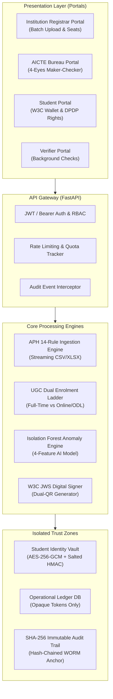
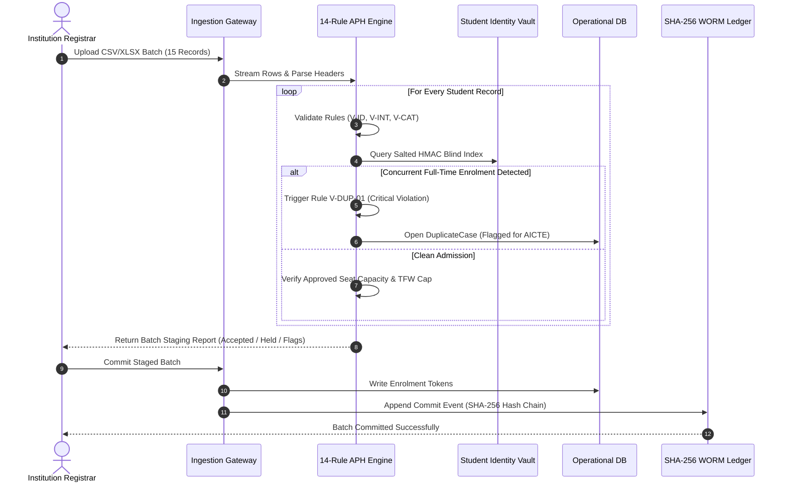
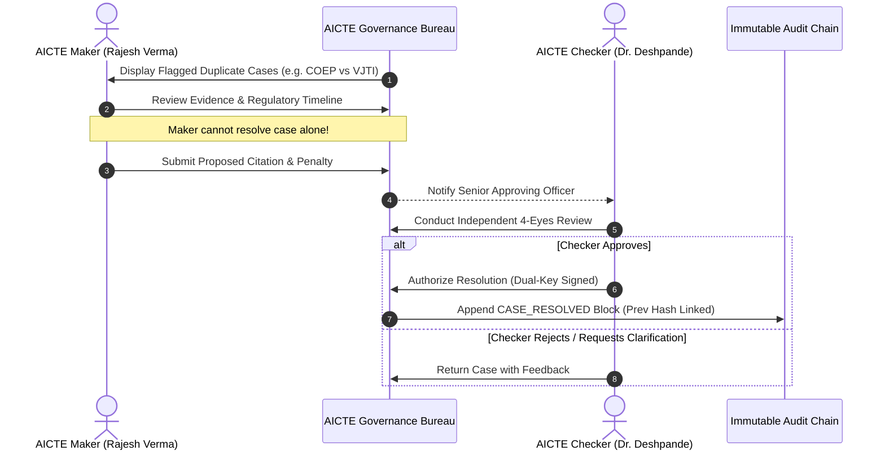
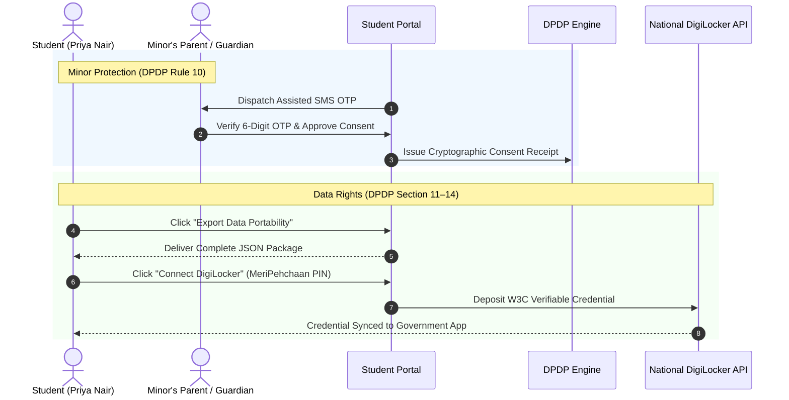
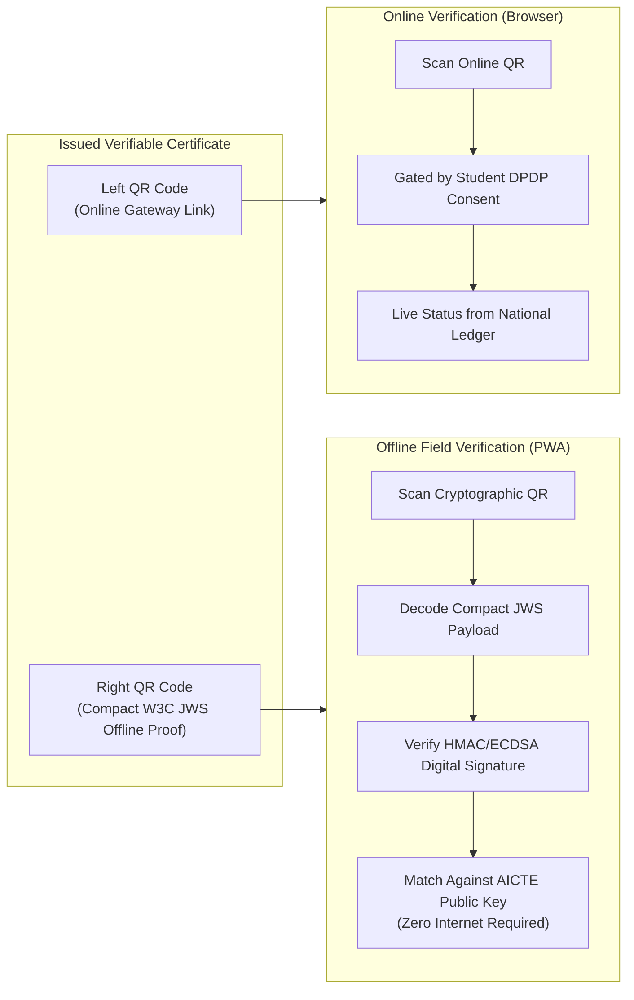

# AICTE APAAR National Student Ledger — SIH 26263
# System Architecture & Technical Flow Diagrams

> **Problem Statement ID:** SIH26263  
> **Architecture Standard:** DPDP Act 2023 · UIDAI Vault · W3C Verifiable Credentials 2.0 · SHA-256 WORM Ledger  

---

## 1. 🏛️ High-Level System Architecture

---

## 2. ⚡ Batch Ingestion & 14-Rule Validation Ladder

---

## 3. ⚖️ 4-Eyes Dual-Key Maker-Checker Governance Flow

---

## 4. 🛡️ DPDP Act 2023 Consent & Data Subject Rights

---

## 5. 🔍 Zero-Trust Credential Verification & Dual-QR Flow

