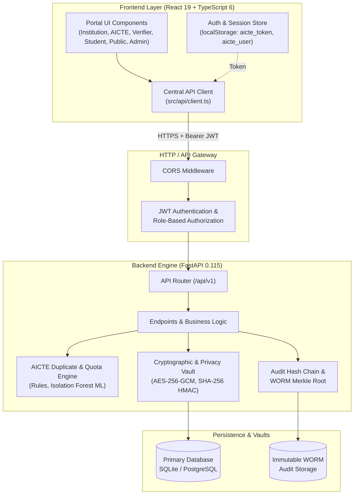

# System Architecture & API Integration Blueprint

**Project**: Agastya SIH / APAAR National Portal (`SIH26263`)  
**Architecture Version**: 2.4.0  
**Stack**: React 19 + TypeScript 6 + Vite 8 (Frontend) | FastAPI + SQLAlchemy + SQLite / PostgreSQL (Backend)

---

## 1. High-Level System Architecture



---

## 2. Central API Client (`src/api/client.ts`)

All network communication is strictly routed through the typed central API client. Direct `fetch` or Axios calls in components are prohibited.

### 2.1 Configuration & Base URL Resolution
- **Environment Base**: `import.meta.env.VITE_API_URL`
- **Production Host**: `https://sih.monu14.me`
- **API Prefix**: `/api/v1`
- **Fallback Rule**: In development, falls back to `https://sih.monu14.me` if `VITE_API_URL` is omitted, guaranteeing that developers always hit the live seeded backend without setup friction.

### 2.2 Token Interception & Header Handling
- On every outgoing request, the client reads `localStorage.getItem('aicte_token')`.
- If present, it injects:
  ```http
  Authorization: Bearer <jwt_token>
  ```
- Content negotiation defaults to:
  ```http
  Content-Type: application/json
  Accept: application/json
  ```
- For multipart file uploads (such as CSV batch uploads), the client omits `Content-Type`, permitting the browser to automatically generate the `multipart/form-data; boundary=...` header.

### 2.3 Error Normalization
- All non-2xx responses are parsed for backend error schemas:
  - Validation failures (`422 Unprocessable Entity`): Extracts field errors from `detail[]`.
  - Business rules (`400 Bad Request`): Extracts violation codes (e.g. `[V-INT-04] Course not approved`).
  - Auth failures (`401 Unauthorized`): Triggers session invalidation and redirects to login.
  - Role restrictions (`403 Forbidden`): Emits permission warning.

---

## 3. End-to-End Traced Communication Flows

### 3.1 Batch CSV Admission & Central Ledger Ingestion
1. **User Action**: Registrar drags admissions CSV into `InstitutionPortal.tsx`.
2. **Frontend Service**: Calls `institutionsApi.uploadCsv(institutionId, formData)`.
3. **HTTP Transport**: `POST /api/v1/institutions/{id}/upload` with `multipart/form-data`.
4. **Backend Processing**:
   - Parses CSV rows against official 11-column AICTE schema.
   - Computes deterministic SHA-256 HMAC for each APAAR ID.
   - Evaluates approved intake quota and supernumerary flags.
   - Identifies cross-college duplicate enrolments.
   - Writes batch ingestion log with status `PROCESSED`.
5. **Frontend Response**:
   - Displays `BatchReport` modal showing verification counts and duplicate warnings.
6. **Commit Action**:
   - Registrar clicks "Commit Valid Enrolments".
   - `POST /api/v1/institutions/{id}/batches/{batch_id}/commit`.
   - Records valid records into Central Ledger and creates block entry in `AuditLedger`.
   - Updates dashboard KPIs and refreshes student registry.

### 3.2 Dual-Control Regulatory Governance (Maker-Checker)
1. **Maker Phase**:
   - AICTE Officer views violation `DUP-2026-*` in `AictePortal.tsx`.
   - Submits proposed penalty via `aicteApi.proposeViolationAction(caseId, 'PENALTY_NOTICE', notes)`.
   - Backend records proposal with `maker_id` and timestamp.
2. **Checker Phase**:
   - Super Admin logs in and reviews pending proposals.
   - Submits approval via `aicteApi.approveViolationAction(caseId, 'APPROVED', notes)`.
   - Backend verifies that `checker_id != maker_id`.
   - Marks case `RESOLVED`, updates seat allocation, and appends cryptographic block to audit trail.

### 3.3 Sovereign DPDP Student Consent Flow
1. **Lookup**: Student logs in; portal fetches active consent requests from `/api/v1/student/{student_token}/consents`.
2. **Action**: Student clicks "Grant" or "Revoke" on an employer verification request.
3. **Mutation**: `POST /api/v1/student/consent/{consent_id}/action` with `{ "action": "GRANTED" }`.
4. **Audit**: Backend logs DPDP compliance event in the audit chain.
5. **Assisted Channel**: Rural students can authorize consent via assisted SMS OTP (`/api/v1/student/consent/assisted-sms-otp`), generating verifiable consent proofs.

### 3.4 Cryptographic Audit Ledger & WORM Anchoring
1. **Hash Chain Structure**:
   - Every state-changing operation generates an immutable block.
   - `block_hash = SHA256(block_index + timestamp + event_type + payload_hash + prev_hash)`.
2. **Integrity Verification**:
   - Frontend calls `aicteApi.verifyChain()`.
   - Backend walks the entire chain from genesis block to tip, verifying all parent hashes.
3. **WORM Anchoring**:
   - Frontend calls `aicteApi.anchorAudit()`.
   - Computes Merkle root of the latest blocks and anchors the root hash to immutable WORM storage with a verifiable timestamp.

---

## 4. Security & Privacy Architecture

| Principle | Implementation |
|---|---|
| **Aadhaar Protection** | Aadhaar numbers are never collected, stored, or transmitted. Identity is verified exclusively through APAAR hashes. |
| **Data Minimization** | Student vault encrypts PII using AES-256-GCM. Public verification only displays masked names and validated credentials. |
| **Dual Control** | AICTE violation resolution enforces Maker-Checker separation at the database and API layer. |
| **Tamper Evidence** | Cryptographic hash chain guarantees immediate detection of unauthorized database modifications. |
| **Zero Mock Masking** | All portal features connect directly to live backend APIs, with clear loading and error feedback. |
