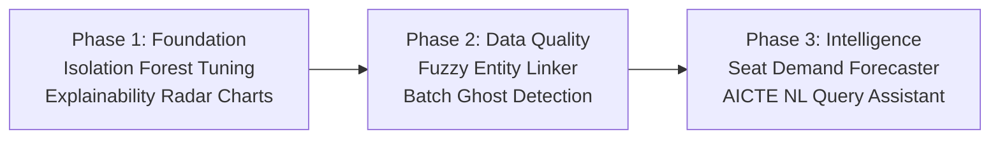

# Machine Learning & AI Implementation Architecture
## AICTE APAAR National Student Data Management & Verification Platform (SIH 2026 · PS-26263)

---

## 1. Executive Summary

In higher education governance, data integrity cannot rely solely on static deterministic rules. Institutions may submit incomplete records, misspelled student names, padded admissions, or synthetic "ghost students" to maximize funding or maintain accreditation status. 

Integrating **Machine Learning (ML)** into the AICTE APAAR platform elevates the system from a passive registry into an **intelligent, proactive regulatory intelligence engine**.

```
┌─────────────────────────────────────────────────────────────────────────────────┐
│                           AICTE APAAR ML ECOSYSTEM                             │
├─────────────────────────┬─────────────────────────────┬─────────────────────────┤
│    Data Ingestion       │    Regulatory Oversight     │   Policy & Forecasting  │
│  • Fuzzy Record Linkage │  • Institutional Risk Score │  • Intake Rationalizer  │
│  • Ghost Student Detect │  • 4-Eyes Trigger Scoring   │  • Seat Demand Forecast │
└─────────────────────────┴─────────────────────────────┴─────────────────────────┘
```

---

## 2. Current State (What is Already in the Codebase)

The backend already features a production-ready, unsupervised anomaly detection pipeline:

* **File**: `SIH-backend/app/services/anomaly_engine.py`
* **Model**: Scikit-Learn `IsolationForest` (`MODEL_VERSION = "iforest-2026.1"`)
* **Endpoint**: `GET /api/v1/aicte/risk-ranking`
* **Frontend View**: `Agastya_Sih/src/pages/aicte/Risk.tsx`

### Current Feature Matrix
1. **Intake Ratio**: $\text{Actual Enrolment within Intake} \div \text{Approved Intake}$
2. **Supernumerary Share**: Ratio of TFW, NRI, PIO, and Lateral Entry seats to total admissions.
3. **Cross-Institution Conflicts**: Count of pending duplicate cases where the institution is implicated.
4. **Padded Return Flag**: Binary indicator ($1.0$ or $0.0$) triggered when an institution reports *exactly* 100% capacity on large intakes ($\ge 50$ seats).

Institutions receive an explainable percentile score ($0.0 \to 1.0$), mapped to `LOW`, `MEDIUM`, or `HIGH` risk tiers, along with rule-grounded natural-language justifications.

---

## 3. Comprehensive ML Architecture & Proposed Modules

```mermaid
flowchart TD
    subgraph Data Sources
        CSV[CSV / XLSX Batch Upload]
        ERP[Institutional ERP REST API]
        APAAR[ABC / APAAR Central Registry]
    end

    subgraph ML Pipeline Stage 1: Ingestion & Validation
        CSV --> PRE[Data Preprocessing & Normalization]
        ERP --> PRE
        PRE --> FUZZY[Module 1: Fuzzy Record Linkage & Deduplication]
        PRE --> GHOST[Module 3: Ghost Student & Batch Anomaly Detection]
    end

    subgraph ML Pipeline Stage 2: Storage & Governance
        FUZZY --> DB[(PostgreSQL / SQLite Central Ledger)]
        GHOST --> DB
        DB --> I_FOREST[Isolation Forest Risk Scorer (Current)]
        DB --> RETENTION[Module 4: Student Retention & Drop-out Risk]
    end

    subgraph ML Pipeline Stage 3: Analytics & Planning
        DB --> FORECAST[Module 2: Intake Demand & Seat Forecasting]
        DB --> NLQ[Module 5: AICTE Policy NL Query Assistant]
    end

    subgraph Stakeholder Portals
        I_FOREST --> AICTE_DASH[AICTE Regulatory Officers]
        FORECAST --> AICTE_DASH
        NLQ --> AICTE_DASH
        FUZZY --> INST_DASH[Institution Registrars]
        GHOST --> INST_DASH
        RETENTION --> INST_DASH
    end
```

---

## 4. Detailed Specification of the 5 Proposed Modules

### Module 1: Fuzzy Identity Resolution & Duplicate Matching (NLP / Record Linkage)

* **Objective**: Flag students enrolled across two institutions under minor typographic differences or with pending/absent APAAR IDs.
* **Target Pipeline**: Batch ingestion step before committing records to the database (`validation_engine.py`).
* **Technical Approach**:
  1. **Phonetic Encoding**: Generate Double-Metaphone and Soundex hashes for Indian student names and father/guardian names.
  2. **String Distance Vectors**:
     * Jaro-Winkler Similarity (gives priority to matching prefix strings).
     * Levenshtein / Damerau-Levenshtein edit distance.
     * Character $n$-gram TF-IDF Cosine Similarity ($n=2, 3$).
  3. **Classification Model**:
     * Train a lightweight `LogisticRegression` or `RandomForestClassifier` on paired records.
     * **Output**: Duplicate Probability Confidence Score ($P_{\text{dup}} \in [0.0, 1.0]$).
     * **Action**:
       * $P \ge 0.85$: Immediate hard conflict warning (`SUSPECTED_CROSS_ENROLMENT`).
       * $0.65 \le P < 0.85$: Soft review notice for institution registrar.

---

### Module 2: Intake & Seat Demand Forecasting (Predictive Analytics)

* **Objective**: Provide AICTE policy makers with data-backed predictions on course saturation, regional seat vacancy, and branch demand for the upcoming academic cycle ($2026-2027$).
* **Target Pipeline**: AICTE National Analytics & Reports Tab (`PublicDashboard.tsx` & `Overview.tsx`).
* **Technical Approach**:
  1. **Historical Features**:
     * Past 3-year sanctioned intake vs actual admission fill-rate.
     * Regional economic index and Tier 1/2/3 district classification.
     * Discipline group (Computer Science/IT, Electronics, Mechanical, Civil, Emerging Tech).
     * Quota utilization rates (General, OBC, SC, ST, EWS, TFW).
  2. **Model**:
     * `HistGradientBoostingRegressor` or `RandomForestRegressor` with Ridge regularization.
  3. **Visual Output**:
     * Projected seat fill rate (%) per branch per state.
     * "Rationalization Suggestions" (e.g., *"Recommend shifting 30 surplus seats from Traditional Mechanical to AI & Robotics in Pune region"*).

---

### Module 3: "Ghost Student" & Cohort Batch Anomaly Detection (Unsupervised ML v2)

* **Objective**: Uncover coordinated admission fraud where rogue institutions generate synthetic student records to claim government welfare schemes or justify faculty-to-student ratios.
* **Target Pipeline**: Triggered on `POST /institutions/batches/{batch_id}/commit`.
* **Technical Approach**:
  1. **Features Extracted per Admission Batch**:
     * Standard deviation of student birth dates (synthetic generators often cluster around identical years/months).
     * Entropy of address postal codes (unnatural clustering of residential pins for regional colleges).
     * Gender and social-category variance compared against district census baselines.
     * Submission timestamp velocity (e.g., hundreds of detailed student records submitted in sub-minute intervals).
  2. **Algorithm**:
     * **Local Outlier Factor (LOF)** or **DBSCAN** to detect outlier clusters within an institutional peer group.
  3. **Action**:
     * Auto-triggers a mandatory AICTE 4-Eyes inspection case before the batch can be locked to the immutable WORM ledger.

---

### Module 4: Student Retention & Drop-out Risk Classifier (NEP 2020 Support)

* **Objective**: Support National Education Policy (NEP 2020) multiple entry/exit pathways by identifying students at high risk of unnotified dropouts or credit stagnation.
* **Target Pipeline**: Institutional Student Registry Management view.
* **Technical Approach**:
  1. **Features**:
     * In-state vs Out-of-state migration indicator.
     * Delay in APAAR / DigiLocker demographic verification ($> 90$ days).
     * Academic Bank of Credits (ABC) credit transfer frequency.
     * Category fee waiver status.
  2. **Model**:
     * Calibrated `XGBoost` or `GradientBoostingClassifier`.
  3. **Output**:
     * Retention risk badge (`STABLE`, `MONITOR`, `AT_RISK`) displayed to institutional counselors for early academic intervention.

---

### Module 5: AICTE Regulatory & Policy Natural Language Assistant (NLP / RAG)

* **Objective**: Empower AICTE officers and institution registrars to query live database metrics and regulatory clauses in natural human language.
* **Target Pipeline**: Floating Assistant / AICTE Command Bar on the dashboard.
* **Capabilities**:
  * **NL-to-SQL / Filter Engine**: Converts questions like *"Which colleges in Maharashtra have more than 15% supernumerary seats in CSE?"* into structured database queries.
  * **Approval Process Handbook (APH) RAG**: Answers compliance questions (e.g., *"What is the maximum allowed Tuition Fee Waiver intake for an autonomous engineering college?"*) using semantic vector search.

---

## 5. Technology Stack & Resource Footprint

| Component | Technology | Rationale |
|---|---|---|
| **Core ML Framework** | `scikit-learn` (v1.4+) | Already installed in `.venv`. Proven, robust, zero external runtime weight. |
| **Numerical Processing** | `numpy`, `pandas`, `scipy` | Ultra-fast vectorized tabular preprocessing and aggregation. |
| **String & Phonetics** | `jellyfish` or pure Python phonetic utilities | Lightweight phonetics (Soundex, Metaphone) with no heavy C-compiler requirements. |
| **Model Persistence** | `joblib` | Atomic `.joblib` serialization allowing cold start times under 50ms. |
| **Compute Overhead** | CPU only (No GPU required) | Completely compatible with standard government server hardware and low-cost cloud instances. |

---

## 6. Implementation Roadmap



### Phase 1: Near-Term Enhancements (Immediate Value)
- [x] Baseline Isolation Forest operational in backend (`anomaly_engine.py`).
- [ ] Add explainability weights (SHAP values / feature contribution bars) to the frontend modal in `Risk.tsx`.
- [ ] Group institutions into peer clusters (e.g. Polytech vs Engineering vs PGDM) before running Isolation Forest.

### Phase 2: Ingestion & Record Integrity
- [ ] Implement `services/dedup_ml.py` for probabilistic duplicate matching during CSV ingest.
- [ ] Add warning badges for fuzzy-matched records on the batch review screen before commitment.

### Phase 3: Strategic AICTE Policy Features
- [ ] Build the Seat Demand & Vacancy Forecasting API endpoint.
- [ ] Add projection visualizer in the AICTE Governance Dashboard.
- [ ] Integrate lightweight Natural Language query routing for AICTE officers.

